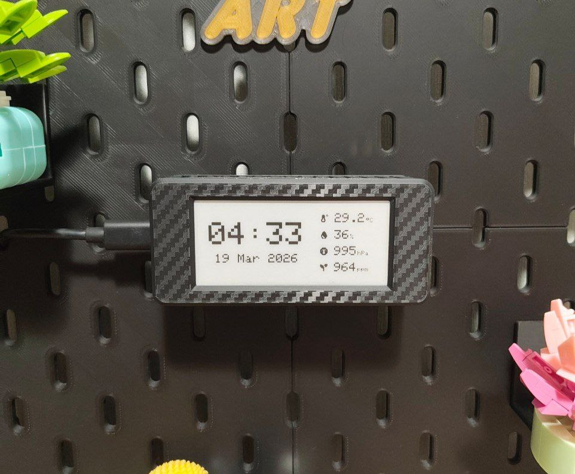
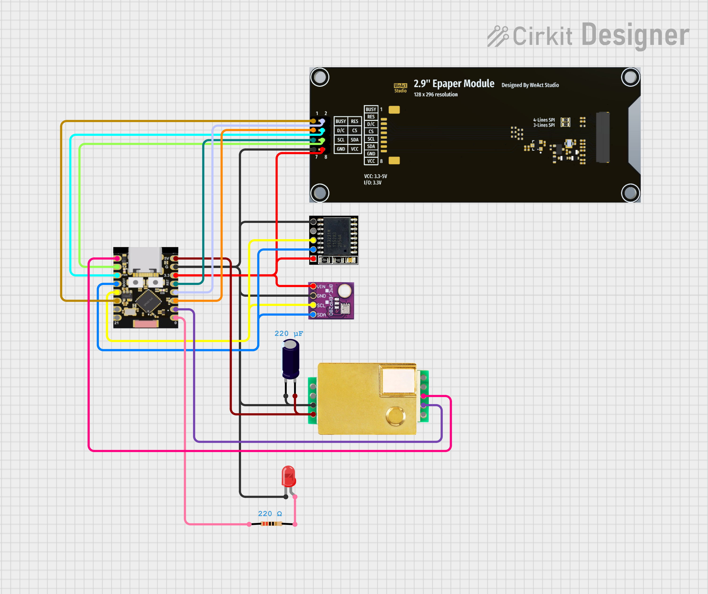

# 🖥️ E-Ink Environment Clock

[](./LICENSE)
[](https://www.espressif.com/en/products/socs/esp32-c3)
[](https://platformio.org/)

**eink-environment-clock** is a minimal ESP32-C3 based E-Ink desk clock that displays time and indoor air data.
It combines a low-power E-Ink screen with CO₂, temperature, humidity, and pressure sensing, making it useful as both a clock and a compact environment monitor.



## 🧩 PCB

PCB design and assembly are illustrated with the following reference images:

```bash
images/
├── assembled_board_image.png
├── circuit_image.png
├── pcb_back_image.png
├── pcb_front_image.png
└── schematic_image.png
```

### Circuit



## 💾 Firmware

The firmware is a pure **ESP-IDF** PlatformIO project (no Arduino). Nothing is configured at compile time: Wi-Fi, MQTT and the screen are set up from the clock's own web page and stored in NVS.

```bash
firmware/
├── platformio.ini
├── partitions.csv        # two OTA slots + NVS
├── web/index.html        # web interface, gzipped into the image at build time
├── test/                 # host unit tests (pio test -e native)
├── tools/                # build helpers, Cyrillic glyph generator
└── src/
    ├── app_main.c        # main loop: sensors, display refresh policy
    ├── app_config.h      # pins, timings
    ├── settings*.c       # user settings, JSON <-> NVS
    ├── wifi_mgr.c        # station + setup access point
    ├── dns_server.c      # captive portal DNS
    ├── web_server.c      # HTTP API, screen preview, OTA
    ├── mqtt_ha.c         # MQTT client, Home Assistant discovery
    ├── ui.c              # layouts, notifications, setup screen
    ├── epd_canvas.c      # 1bpp canvas, UTF-8 text, Latin + Cyrillic font
    └── epd_ssd1680.c     # e-paper driver (WeAct 2.9" B/W, SSD1680)
```

### Flashing

The partition table has two OTA slots. Erase the flash once when coming from an older firmware, then build and flash over the native USB of the ESP32-C3 Super Mini:

```bash
cd firmware
pio run -t erase
```

```bash
pio run -t upload && pio device monitor
```

Later updates can be uploaded from the **System** tab of the web interface (`.pio/build/esp32-c3-supermini/firmware.bin`). If a new image does not start, the bootloader returns to the previous one.

### Wi-Fi setup

| Situation | What the clock does |
|---|---|
| No saved network | Starts the access point `EinkClock-XXXX` right away and shows the setup screen |
| Saved network unreachable for 30 s | Starts the access point and keeps retrying the saved network; the clock keeps running and shows the access point details in a strip at the bottom |
| Connected | Shows its address at the bottom of the screen for two minutes; the access point stops after one minute |

The access point uses WPA2 with a new 8-digit password every time it starts. The screen shows the network name, the password, a QR code for joining it and the address `192.168.4.1`. Phones open the setup page on their own (captive portal).

To forget the Wi-Fi and MQTT settings without the web page, plug the clock in three times in a row, unplugging it within five seconds each time.

### Web interface

Open `http://<clock-ip>/` or `http://eink-clock-<id>.local/`. English and Russian, light and dark theme.

| Tab | Contents |
|---|---|
| Overview | Panel contents, readings, notification form, status |
| Display | Layout (clock + readings, clock, CO₂, readings), which readings and their order, date and time format, time zone, units, invert, rotate; live preview rendered by the clock |
| Network | Wi-Fi scan and connection, MQTT broker |
| System | Device name, CO₂ threshold, temperature correction, CO₂ calibration, firmware update, restart and reset |

### Home Assistant

Enable MQTT on the **Network** tab and point it at the broker used by Home Assistant. The clock announces itself through MQTT discovery, so it shows up as a device without YAML.

| Entity | Type |
|---|---|
| Temperature, humidity, pressure, CO₂, Wi-Fi signal, uptime | `sensor` |
| CO₂ above threshold | `binary_sensor` |
| Notification | `text` |
| Clear notification, restart, calibrate CO₂ | `button` |
| Screen layout | `select` |
| CO₂ threshold | `number` |

Notifications with an expiry or full-screen display go to `eink-clock/<id>/notify`:

```yaml
action: mqtt.publish
data:
  topic: eink-clock/a1b2c3/notify
  payload: '{"text": "Open the window", "ttl": 600, "fullscreen": true}'
```

### Updates

Releases are published by CI: pushing a version tag (commitizen format, e.g. `1.1.0`) builds the firmware with that version and attaches `firmware.bin` to a GitHub release.

```sh
cz bump && git push --follow-tags
```

The clock checks the latest release once a day (**System → Firmware update**, on by default) and shows its notes with an **Install** button. With automatic updates on, a newer release is installed between 03:00 and 05:00 local time. Downloads go over HTTPS; if the new image does not start, the bootloader returns to the previous one. Settings live in the `nvs` partition and survive updates.

### Developer tools

The **Developer** tab shows the device log live (the last 12 KB since boot, filter by level and text, download), changes the log level per tag, sends arbitrary API requests and shows the raw `/api/state` JSON.

### HTTP API

No keys or accounts. All endpoints return JSON except the screen images.

| Method | Path | Purpose |
|---|---|---|
| `GET` | `/api/state` | Readings, time, Wi-Fi, MQTT, notification, device info |
| `GET` / `POST` | `/api/config` | Settings; `POST` accepts a partial object |
| `GET` | `/api/screen.bmp` | What the panel shows now |
| `POST` | `/api/preview` | Renders unsaved settings, returns BMP |
| `POST` / `DELETE` | `/api/notify` | Show or clear a notification |
| `GET` | `/api/wifi/scan` | Nearby networks |
| `POST` | `/api/wifi` | Save a network and connect |
| `POST` | `/api/co2/calibrate` | MH-Z19 zero point (400 ppm) |
| `POST` | `/api/ota` | Firmware image as the request body |
| `GET` | `/api/update` | Running and latest release, update progress |
| `POST` | `/api/update/check`, `/api/update/install` | Check GitHub now, install the latest release |
| `GET` | `/api/logs?since=N` | Device log after position `N` |
| `POST` | `/api/log-level` | `{"level": "debug", "tag": "*"}` |
| `POST` | `/api/system/reboot`, `/forget-wifi`, `/factory-reset` | Maintenance |

```bash
curl -X POST http://192.168.1.42/api/notify -d '{"text": "Meeting until 15:00", "ttl": 3600}'
```

### Tests

Settings, layouts, text wrapping, the Cyrillic font, notifications and the MQTT payloads are plain C and run on the host. The ESP-IDF package must be installed once (any `pio run` does it), because the tests use its cJSON:

```bash
cd firmware
pio test -e native
```

Set `PREVIEW_DIR` to get every rendered test screen as a PBM image:

```bash
PREVIEW_DIR=/tmp/screens pio test -e native -f test_ui
```

## 📚 Libraries

Sensors are handled by [esp-idf-lib](https://esp-idf-lib.readthedocs.io/) components (fetched automatically from the ESP Component Registry):

* **bmp280** — BME280 temperature / humidity / pressure
* **ds3231** — RTC
* **mhz19b** — CO₂ sensor

The QR code on the setup screen is drawn with [QR Code generator](https://github.com/nayuki/QR-Code-generator) by Project Nayuki (MIT), vendored in `src/third_party`.

The e-paper driver is custom and follows the panel vendor's reference code from [WeActStudio.EpaperModule](https://github.com/WeActStudio/WeActStudio.EpaperModule).

## 📦 Case

The case model for this project is located in:

```bash
3d_model/
├── stp
│   ├── backplate.stp
│   ├── center.stp
│   └── frontplate.stp
├── case.3mf
└── case.m3d
```

## ⚠️ Known Issues

* Holes for the **MH-Z19** are too small.
* Some modules (**MH-Z19**) are placed too close to the mounting holes, which sometimes makes assembly and fastening inconvenient.

## 📜 License

This project is licensed under the MIT License. See the [LICENSE](./LICENSE) file for details.
